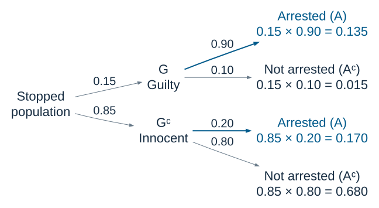

```{r}
#| label: setup
#| include: false
knitr::read_chunk("conditional-probability-demo.R")
```

## Today's questions

- How does learning an event occurred change a probability?
- When does information leave a probability unchanged?
- How can a probability tree give us Bayes' rule?
- How can we simulate the process that produced the information?

**Reading:** Blitzstein and Hwang, Chapter 2.

We keep PSD's emphasis on specifying a process and simulating it in R.

## Conditional probability

For events $A$ and $B$, with $P(B)>0$,

$$P(A\mid B)=\frac{P(A\cap B)}{P(B)}.$$

Knowing $B$ occurred restricts attention to outcomes in $B$.

The numerator keeps outcomes where **both** $A$ and $B$ occur.
The denominator rescales their probability relative to $B$.

$A^c$ means the complement of $A$, just as $\overline A$ did last week.

## A conditional probability in a table

Choose one respondent uniformly from the table's 2,010 respondents.

| Recorded sex | Democrat | Independent | Republican | Total |
|---|---:|---:|---:|---:|
| Male | 427 | 169 | 330 | 926 |
| Female | 556 | 191 | 337 | 1,084 |
| Total | 983 | 360 | 667 | 2,010 |

Let $R$ mean Republican and $F$ mean recorded as female.

$$\underbrace{P(R)=\frac{667}{2010}\approx0.332}_{\text{unconditional (marginal)}}
\qquad
\underbrace{P(R\mid F)=\frac{337}{1084}\approx0.311}_{\text{conditional on female}}.$$

Based on old ANES data. These are sample proportions.

## Reversing the conditioning

The **same intersection** can appear in two different questions:

$$P(R\mid F)=\frac{337}{1084}\approx0.311,$$

$$P(F\mid R)=\frac{337}{667}\approx0.505.$$

What changes is the reference group in the denominator.

**Question:** Which probability describes the composition of Republicans, as opposed to the composition of females?

## The multiplication rule

Rearranging the definition gives

$$P(A\cap B)=P(A\mid B)P(B)=P(B\mid A)P(A).$$

This rule applies whether the events are independent or dependent.

For a path through a probability tree, multiply the probability of the
first branch by the conditional probability of the next branch.

## Independence

With $P(A)>0$ and $P(B)>0$, **independence** means

$$P(A\mid B)=P(A),\qquad P(B\mid A)=P(B).$$

Substitute into either form of the general multiplication rule:

$$\begin{aligned}
P(A\cap B)&=\underbrace{P(A\mid B)}_{P(A)}P(B)=P(A)P(B),\\
P(A\cap B)&=\underbrace{P(B\mid A)}_{P(B)}P(A)=P(B)P(A).
\end{aligned}$$

The criterion $P(A\cap B)=P(A)P(B)$ also covers zero-probability events.
Independence needs justification in the model.

## Independence in last week's voting example

Let $C$ and $V$ mean planning to vote in the congressional and presidential elections.

| | $V$ | $V^c$ | Total |
|---|---:|---:|---:|
| $C$ | 0.35 | 0.01 | 0.36 |
| $C^c$ | 0.20 | 0.44 | 0.64 |
| Total | 0.55 | 0.45 | 1.00 |

$$P(C\mid V)=\frac{0.35}{0.55}\approx0.636\ne0.36=P(C).$$

These events are dependent. Equivalently, $0.35\ne(0.36)(0.55)$.

## Disjointness and independence

**Disjoint:** $A\cap B=\emptyset$. The events cannot both occur.

**Independent:** $P(A\cap B)=P(A)P(B)$.

If disjoint events both have positive probability,

$$P(A\mid B)=0\ne P(A).$$

So they are dependent: learning that one occurred rules out the other.

**Example:** “Chosen respondent is a Democrat” and “chosen respondent is a Republican.”

## The law of total probability

Suppose $A_1,\ldots,A_n$ partition the sample space:
they are disjoint and together cover all outcomes.

For positive-probability pieces,

$$P(B)=\sum_{i=1}^n P(B\mid A_i)P(A_i).$$

In the two-part case,

$$P(B)=P(B\mid A)P(A)+P(B\mid A^c)P(A^c).$$

It is a **weighted average** of conditional probabilities.

## Total probability in the voting table

Partition by presidential voting plans, $V$ and $V^c$.

$$P(C)=P(C\mid V)P(V)+P(C\mid V^c)P(V^c).$$

$$P(C)=\left(\frac{0.35}{0.55}\right)0.55
+\left(\frac{0.01}{0.45}\right)0.45=0.36.$$

The terms recover two disjoint pieces: $C\cap V$ and $C\cap V^c$.

We do **not** need independence to use total probability.

## The arrest example: a hypothetical model

Select a person from a defined population **already stopped by police**.

- $G$: the person committed the specified offense.
- $A$: police arrest the person for that offense.

Assume

$$P(G)=0.15,\qquad P(A\mid G)=0.90,\qquad P(A\mid G^c)=0.20.$$

What are $P(A)$ and $P(G\mid A)$?

These are invented teaching numbers, not crime or policing estimates.

## The probability tree

{width=8.4in fig-alt="Tree of guilt and arrest: joint probabilities 0.135, 0.015, 0.170, and 0.680."}

Each second-stage probability conditions on the first-stage branch.

## Multiplication along a path

The four complete paths have probabilities

| Outcome | Calculation | Probability |
|---|---:|---:|
| $G\cap A$ | $0.15\times0.90$ | 0.135 |
| $G\cap A^c$ | $0.15\times0.10$ | 0.015 |
| $G^c\cap A$ | $0.85\times0.20$ | 0.170 |
| $G^c\cap A^c$ | $0.85\times0.80$ | 0.680 |

**Check:** The four disjoint paths cover the sample space and sum to 1.

## Total probability gives the arrest rate

An arrest can occur on either of two disjoint paths:

$$P(A)=P(A\mid G)P(G)+P(A\mid G^c)P(G^c)$$

$$=(0.90)(0.15)+(0.20)(0.85)=0.305.$$

In a hypothetical group of 1,000 stopped people:

- 135 are guilty and arrested.
- 170 are innocent and arrested.
- Total arrested: 305.

## Conditioning on arrest

Among the 305 arrested people, 135 are guilty:

$$P(G\mid A)=\frac{P(G\cap A)}{P(A)}
=\frac{0.135}{0.305}\approx0.443.$$

Compare:

$$P(A\mid G)=0.90\qquad\text{and}\qquad P(G\mid A)\approx0.443.$$

The second quantity depends on the base rate and the false-arrest rate too.

## Bayes' rule emerges from the tree

Start with the conditional probability we want:

$$P(G\mid A)=\frac{P(G\cap A)}{P(A)}.$$

Use the multiplication rule in the numerator:

$$P(G\mid A)=\frac{P(A\mid G)P(G)}{P(A)}.$$

Use total probability in the denominator:

$$P(G\mid A)=\frac{P(A\mid G)P(G)}
{P(A\mid G)P(G)+P(A\mid G^c)P(G^c)}.$$

## The general form of Bayes' rule

For $P(H)>0$ and $P(E)>0$,

$$\underbrace{P(H\mid E)}_{\text{posterior}}
=\frac{\overbrace{P(E\mid H)}^{\text{likelihood}}\,
\overbrace{P(H)}^{\text{prior}}}{P(E)}.$$

The denominator includes **every modeled way** the evidence can occur.

All quantities on the right use the model **before** conditioning on $E$.
Knowing $E$ happened does not make that denominator 1.

## Changing the arrest model

Hold $P(A\mid G)=0.90$ fixed.

| Scenario | $P(G)$ | $P(A\mid G^c)$ | $P(A)$ | $P(G\mid A)$ |
|---|---:|---:|---:|---:|
| Original | 0.15 | 0.20 | 0.305 | 0.443 |
| More false arrests | 0.15 | 0.50 | 0.560 | 0.241 |
| Higher prior | 0.30 | 0.20 | 0.410 | 0.659 |

**Discuss:** Why does the posterior fall in the second row and rise in the third?

Each row is a separate hypothetical model. The table describes probabilities,
not a standard for legal guilt.

## Before the break

1. What is the denominator in $P(G\mid A)$?
2. Why is the denominator $P(A)$, rather than $P(A\mid G)$?
3. Where did we use total probability in the tree?
4. To estimate $P(G\mid A)$ from 100,000 simulated stopped people, which people enter the denominator, and which enter the numerator?

## Break

After the break: Monty Hall, then a model of competing coalitions.

For each, we will specify the process, solve it analytically, and simulate it.

## Monty Hall: the rules

- Three doors conceal one car and two goats. The car's location is uniform.
- You choose a door. Label your initial choice door 1.
- Monty knows the car's location. He **always** opens an unchosen goat door
  and **always** offers you a switch.
- If two goat doors are available, he chooses between them with equal probability.

Should you stay with door 1 or switch to the other closed door?

## An analytical solution by cases

Let $C_i$ mean that the car is behind door $i$.

| Car location | Probability | Staying | Switching |
|---|---:|---|---|
| $C_1$ | $1/3$ | Win | Lose |
| $C_2$ | $1/3$ | Lose | Win |
| $C_3$ | $1/3$ | Lose | Win |

By total probability,

$$P(\text{switch wins})=0\cdot\frac13+1\cdot\frac13+1\cdot\frac13=\frac23.$$

Switching wins exactly when the initial choice misses the car.

## The information in Monty's choice

Suppose Monty opens **door 3**. Call this event $M_3$.

| Car location | Prior | $P(M_3\mid C_i)$ | $P(M_3\cap C_i)$ |
|---|---:|---:|---:|
| $C_1$ | $1/3$ | $1/2$ | $1/6$ |
| $C_2$ | $1/3$ | $1$ | $1/3$ |
| $C_3$ | $1/3$ | $0$ | $0$ |

$$P(M_3)=\frac16+\frac13=\frac12.$$

**Question:** Why is the middle likelihood 1?

## Bayes' rule after door 3 opens

$$P(C_2\mid M_3)=\frac{P(M_3\mid C_2)P(C_2)}{P(M_3)}
=\frac{1\cdot(1/3)}{1/2}=\frac23.$$

Similarly, $P(C_1\mid M_3)=1/3$.

Two closed doors remain, but they have **unequal conditional probabilities**.

The $1/2$ likelihood in the previous table uses Monty's stated rule for
choosing between two goats.

## The 100-door intuition

Imagine one car behind 100 doors.

Your initial door has probability $1/100$ of hiding the car.
The other 99 doors collectively have probability $99/100$.

Monty knows where the car is. He opens 98 unchosen goat doors,
leaving one unchosen door closed.

Switching wins whenever your first choice was wrong:

$$P(\text{switch wins})=\frac{99}{100}.$$

His informed removal of goats preserves your opportunity to win by switching.

## A simulation of one complete game

One trial needs to generate the information Monty reveals:

1. Choose the car's location uniformly.
2. Fix our initial choice at door 1.
3. Identify unchosen doors that contain goats.
4. Let Monty choose one of those doors.
5. Record whether staying and switching would win.

The two strategies can be compared **in the same simulated game**.

## A small sampling helper

```{r}
#| label: pick-one
```

`pick_one(c(2, 3))` selects door 2 or door 3.

`pick_one(3)` selects door 3 with certainty.

Sampling an **index** handles a list containing just one door safely.

## Monty Hall in R

```{r}
#| label: monty-function
```

`setdiff(x, y)` keeps the values in `x` that do not appear in `y`.

## Repeating the game

```{r}
#| label: monty-repeat
```

Each column of `games` is one complete trial.
The transposed preview shows one trial per row. Here 1 means a win, 0 a loss.

## Simulation and the analytical answer

```{r}
#| label: monty-results
```

The simulation proportions are close to $1/3$ and $2/3$.

More trials reduce Monte Carlo noise. They cannot repair an incorrect host model.

## Conditioning in a simulation

```{r}
#| label: monty-conditional
```

We keep only games in which Monty opened door 3, then measure switching wins.

$$\widehat P(C_2\mid M_3)=
\frac{\#\{\text{car at 2 and Monty opens 3}\}}{\#\{\text{Monty opens 3}\}}.$$

## Simulation proportions settle near the target

```{r}
#| label: monty-convergence
#| echo: false
#| fig-width: 9.5
#| fig-height: 3.9
```

The path fluctuates. A larger sample need not be closer at every step.

## A political analogue: competing coalitions

Two coalitions compete for **four delegates**. Coalition A starts with one.

In each round before unanimity:

- With probability $1/2$, A gains one delegate from B.
- Otherwise, A loses one delegate to B.
- The round's direction is independent of earlier rounds.

The process stops when A has 0 or 4 delegates.

What is the probability that A eventually wins all four?

This is a stylized adaptation of B&H Example 2.7.3, not an empirical model.

## One complete contest

Possible path: A's delegate count starts at 1 and changes by one each round.

$$1,\ 2,\ 1,\ 2,\ 3,\ 4.$$

This trial ends in a win. Another path, $1,0$, ends in a loss.

**A simulation trial is the entire contest**, not a single round.

States 0 and 4 are absorbing: the contest ends as soon as either is reached.

## Conditioning on the first round

Let $u_i=P(\text{A eventually wins}\mid\text{A starts with }i)$.

We know $u_0=0$ and $u_4=1$.

For $i=1,2,3$, total probability gives

$$u_i=\frac12u_{i+1}+\frac12u_{i-1}.$$

After the first round, we face the same problem with a different starting count.

This is the book's **first-step analysis** strategy.

## Solving the small system

Rearrange the first-step equation:

$$u_{i+1}-u_i=u_i-u_{i-1}.$$

The probabilities increase in equal steps between $u_0=0$ and $u_4=1$:

| Starting delegates | 0 | 1 | 2 | 3 | 4 |
|---|---:|---:|---:|---:|---:|
| A's chance of winning | 0 | $1/4$ | $1/2$ | $3/4$ | 1 |

A starts with one delegate, so its chance is **$1/4$**.

Fair rounds do not erase an unequal starting position.

## Simulating a complete contest

```{r}
#| label: coalition-function
```

`while` repeats until the contest reaches 0 or 4.
`&&` requires both scalar conditions to hold.

## Repeating the coalition contest

```{r}
#| label: coalition-repeat
```

The function returns one logical result per complete contest.

`mean()` converts `TRUE` and `FALSE` to 1 and 0 and estimates the win probability.

## Changing the initial support

```{r}
#| label: coalition-starts
#| echo: false
```

The probabilities depend on where the contest starts, even though every
individual round uses the same fair rule.

**Discuss:** Which assumptions would you change for a more realistic coalition model?

## What to carry forward

- Conditional probability changes the reference group.
- Independence tells us when conditioning leaves a probability unchanged.
- Total probability combines disjoint cases using their probabilities as weights.
- Bayes' rule reverses the conditioning by accounting for how evidence arises.
- A simulation must reproduce the relevant process, including selection and stopping rules.

**Exit question:** To estimate $P(A\mid B)$, which simulated trials belong in the denominator?

## Sources and further reading

Joseph K. Blitzstein and Jessica Hwang (2019), *Introduction to Probability*,
2nd edition, Chapter 2. [Official free reader](https://probabilitybook.net).

- Definitions, Bayes' rule, total probability: §§2.2-2.4.
- Independence: §2.5.
- Monty Hall: Example 2.7.1 and §2.10.
- Coalition adaptation: Example 2.7.3 (gambler's ruin).

Simulation approach: [*Probability, Statistics, and Data*, Chapter 2](https://probstatsdata.com/probchapter.html).

Tables and arrest parameters adapted from the 2017 POLI 210 probability slides.
The political processes and their interpretations here are teaching models.
