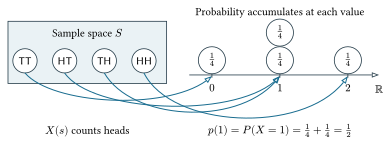
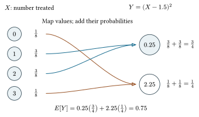

```{r}
#| label: setup
#| include: false
knitr::read_chunk("discrete-rv-demo.R")
invisible(capture.output(sys.source("discrete-rv-demo.R", envir = knitr::knit_global())))
```

## Today's questions

- How does an experiment produce a numerical outcome?
- How does probability on outcomes become a distribution over numbers?
- What do a distribution's mean and variance tell us?
- How can we compare exact calculations with simulated experiments?

**Reading:** Speegle and Clair, *Probability, Statistics, and Data*, Chapter 3.

## Outcomes, events, and random variables

For two coin flips, the sample space is

$$S=\{TT,HT,TH,HH\}.$$

An **outcome** is one complete result, such as $HT$.

An **event** is a set of outcomes, such as $\{HT,TH\}$.

A **random variable** is a numerical function of the outcome:

$$X:S\to\mathbb R,\qquad X(s)=\text{number of heads in }s.$$

## Mapping outcomes to numbers

::: {.diagram}
{width=95% fig-alt="TT maps to zero heads, HT and TH map to one, and HH maps to two. Two quarter-probability masses stack at one."}
:::

Independent fair flips give each outcome probability $1/4$.

::: {.source}
Recreated after Matthew Blackwell's slide 11, used with permission.
:::

## The induced probability distribution

Both $HT$ and $TH$ map to 1, so

$$\{X=1\}=\{HT,TH\},\qquad P(X=1)=\frac14+\frac14=\frac12.$$

The **probability mass function** gives $p(x)=P(X=x)$.

| $x$ | 0 | 1 | 2 |
|---|---:|---:|---:|
| $p(x)$ | $1/4$ | $1/2$ | $1/4$ |

Equally likely outcomes can produce values with unequal probabilities.

## A different summary of the same experiment

Define $W=1$ when the two flips match and $W=0$ otherwise.

| Outcomes | $W$ | Total probability |
|---|---:|---:|
| $TT,HH$ | 1 | $1/2$ |
| $HT,TH$ | 0 | $1/2$ |

The experiment and its outcome probabilities stay the same.

We change the numerical function that summarizes the outcome.

## What makes a random variable discrete?

A discrete random variable has **finitely or countably many** possible values.

- A count of treated people takes values $0,1,2,\ldots$.
- The fraction of heads in two flips takes values $0,1/2,1$.
- A waiting time measured in whole calls may have no finite upper bound.

The values need not be integers.

Its PMF satisfies $p(x)\ge0$ and $\sum_x p(x)=1$.

## A voter-mobilization experiment

Three people are eligible for a mobilization message.

Independently assign each person to treatment $T$ or control $C$ with
probability $1/2$.

Let $X$ count the people assigned to treatment.

**Question:** What values can $X$ take? Are they equally likely?

This hypothetical assignment mechanism describes who receives the message.
It makes no claim about the message's effect.

## The treatment-count PMF

| Outcomes | $x$ | Count: $\binom{3}{x}$ | Prob. per outcome | $p(x)$ |
|---|---:|---:|---:|---:|
| $CCC$ | 0 | 1 | $1/8$ | $1/8$ |
| $TCC,CTC,CCT$ | 1 | 3 | $1/8$ | $3/8$ |
| $TTC,TCT,CTT$ | 2 | 3 | $1/8$ | $3/8$ |
| $TTT$ | 3 | 1 | $1/8$ | $1/8$ |

**Counting connection:** Choose which $x$ of the three people receive treatment.

In R, `choose(3, 0:3)` gives `1, 3, 3, 1`.

$$P(\text{both groups exist})=P(X=1)+P(X=2)=\frac34.$$

**Catch:** Independent coin flips do not guarantee fixed group sizes.

## Enumeration in R

```{r}
#| label: enumerate-slide
assignments <- expand.grid(person1 = c("C", "T"),
                           person2 = c("C", "T"),
                           person3 = c("C", "T"))
number_treated <- rowSums(assignments == "T")
table(number_treated) / nrow(assignments)
```

Each row is one complete assignment. We count outcomes exactly here.

**Live demo 1:** Inspect the rows and their numerical summaries.

## Simulating the assignment mechanism

```{r}
#| label: assignment-sim
```

One repetition represents one experiment with **three people**.

Each entry of `X` records one treatment count.

**Live demo 2:** Predict which counts will occur most often.

## Simulating directly from the PMF

```{r}
#| label: direct-slide
set.seed(92302)
X_direct <- sample(0:3, 20000, replace = TRUE,
                   prob = c(1, 3, 3, 1) / 8)
X_binom <- rbinom(20000, size = 3, prob = .5)
```

These commands produce counts directly, without retaining individual assignments.

**Catch:** `sample(0:3, 20000, replace=TRUE)` would give the four counts
equal probabilities. That would describe a different model.

## Exact and simulated distributions

```{r}
#| label: pmf-plot
#| echo: false
#| fig-width: 10
#| fig-height: 3.4
```

More repetitions improve the approximation of the fixed PMF.

They do not reduce variation across individual three-person experiments.

## Expected value

For a discrete random variable with finite expectation,

$$E[X]=\sum_x x\,p(x).$$

The expectation is a probability-weighted average of the possible values.

Think of probability weights placed on a number line. The expectation is
their balance point.

**Question:** Must that balance point be a value $X$ can actually take?

## The expected treatment count

| $x$ | $p(x)$ | $x p(x)$ |
|---:|---:|---:|
| 0 | $1/8$ | 0 |
| 1 | $3/8$ | $3/8$ |
| 2 | $3/8$ | $6/8$ |
| 3 | $1/8$ | $3/8$ |

$$E[X]=0\left(\frac18\right)+1\left(\frac38\right)
+2\left(\frac38\right)+3\left(\frac18\right)=1.5.$$

Every actual experiment treats an integer number of people.

## An average and an event probability

```{r}
#| label: expectation
```

`mean(X)` averages treatment counts.

`mean(X == 0 | X == 3)` averages an event indicator.

**Live demo 3:** Compare the two quantities and explain their units.

## Why repeated simulation works

With independent repetitions of the same model and finite expected absolute
value, the **Law of Large Numbers** links sample averages to expectations.

For an indicator $D$ with $P(D=1)=p$,

$$E[D]=0(1-p)+1p=p.$$

This is why the average of a logical comparison estimates a probability.

**Catch:** A larger simulation need not be closer on every run.

## Break

Before we pause:

Why can equally likely experiment outcomes produce a nonuniform PMF?

After the break: polling, transformations, and variation.

## Bernoulli trials and binomial counts

A Bernoulli variable is 1 for an event labeled success and 0 otherwise.

Suppose $n$ trials are independent and each has success probability $p$.
Let $X$ count successes. Then

$$X\sim\operatorname{Binom}(n,p),$$

$$P(X=x)=\binom{n}{x}p^x(1-p)^{n-x},\qquad x=0,\ldots,n.$$

The assumptions are part of the model. A count alone need not be binomial.

## Where the binomial formula comes from

For exactly $x$ successes in $n$ trials:

1. Choose the $x$ successful positions: $\binom{n}{x}$ choices.
2. Each sequence has probability $p^x(1-p)^{n-x}$.
3. Add the probabilities of those disjoint sequences.

Our experiment has $X\sim\operatorname{Binom}(3,1/2)$:

$$p(x)=\binom{3}{x}(1/2)^3.$$

## A polling model

Suppose a fixed **46%** of a large voter population supports Peyton.
A poll samples **300 voters**. Let $K$ count Peyton supporters.

$$K\sim\operatorname{Binom}(300,.46),\qquad E[K]=138.$$

Sampling without replacement is approximately binomial when the poll is
a small share of the population.

What is the probability Peyton has a **strict majority in the sample**?

::: {.source}
Hypothetical setup from PSD Example 3.21. We do not model turnout or nonresponse.
:::

## The probability of a sample lead

A strict majority requires $K>150$. A 150-150 tie does not count.

```{r}
#| label: poll-tail-slide
pbinom(150, size = 300, prob = .46, lower.tail = FALSE)
```

$$P(K>150)\approx .074.$$

This probability describes repeated polls under assumed population support.
It is not a posterior probability of winning the election.

## The tail of the polling distribution

```{r}
#| label: poll-plot
#| echo: false
#| fig-width: 10
#| fig-height: 3.6
```

The orange masses represent polls with 151 or more Peyton supporters.

## Cumulative distribution functions

$$F(x)=P(X\le x)=\sum_{u\le x}p(u).$$

```{r}
#| label: cdf-plot
#| echo: false
#| fig-width: 10
#| fig-height: 2.6
```

For the treatment count, $F(1)=F(1.4)=1/2$.

**Live demo 5:** Inspect the filled and open endpoints.

## Boundary conditions and R prefixes

| Command | Question it answers |
|---|---|
| `dbinom(x, n, p)` | $P(K=x)$ |
| `pbinom(x, n, p)` | $P(K\le x)$ |
| `rbinom(N, n, p)` | Generate $N$ counts |

`lower.tail=FALSE` gives $P(K>x)$.

For integer-valued $K$,

$$P(K\ge k)=P(K>k-1).$$

**Catch:** $P(X<1)=1/8$, while $P(X\le1)=1/2$ in our treatment example.

## Simulating many polls

```{r}
#| label: poll-sim
```

**20,000** counts repeated polls. **300** counts voters within each poll.

**Live demo 4:** Compare a strict lead with a tie or lead.

## Transforming a random variable

::: {.diagram}
{width=78% fig-alt="Values zero and three map to 2.25. Values one and two map to 0.25. Their probabilities combine at those destinations."}
:::

## Expectation after a transformation

Let $Y=g(X)=(X-1.5)^2$. We can average using the original probabilities:

$$E[g(X)]=\sum_x g(x)p(x)=.75.$$

```{r}
#| label: transform
```

**Catch:** $E[(X-1.5)^2]=.75$, but $(E[X]-1.5)^2=0$.

**Live demo 6:** Apply the function to every simulated count.

## Variance and standard deviation

For $\mu=E[X]$,

$$\operatorname{Var}(X)=E[(X-\mu)^2]
=\sum_x(x-\mu)^2p(x).$$

$$\operatorname{SD}(X)=\sqrt{\operatorname{Var}(X)}.$$

Signed deviations average to zero. Squared deviations measure spread.

Our treatment count has variance $.75$ and standard deviation
$\sqrt{.75}\approx .866$ people.

## Center and spread

```{r}
#| label: spread-plot
#| echo: false
#| fig-width: 10
#| fig-height: 3.5
```

Middle: one shared coin assigns everyone to the same group.

Right: adding 1 shifts the mean and preserves the variance.

## Variance in R

```{r}
#| label: variance-slide
mu <- sum((0:3) * c(1, 3, 3, 1) / 8)
c(model_variance = sum(((0:3) - mu)^2 * c(1, 3, 3, 1) / 8),
  mean_squared_deviation = mean((X - mu)^2),
  sample_variance = var(X))
```

`var(X)` uses the sample mean and denominator $N-1$.

`mean((X-mu)^2)` uses the known model mean. Their finite-simulation
values can differ slightly.

## Linearity of expectation

For finite expectations,

$$E[aX+bY+c]=aE[X]+bE[Y]+c.$$

**Independence is unnecessary for this rule.**

If $D_i$ indicates success on trial $i$, with $P(D_i=1)=p$,

$$E\left[\sum_{i=1}^nD_i\right]=\sum_{i=1}^nE[D_i]=np.$$

This gives the binomial mean.

## Variance under shifting and scaling

$$\operatorname{Var}(aX+b)=a^2\operatorname{Var}(X).$$

Adding $b$ shifts the center without changing distances from it.

Multiplying by $a$ multiplies each deviation by $a$, and its square by $a^2$.

An equivalent formula is

$$\operatorname{Var}(X)=E[X^2]-E[X]^2.$$

## Independence and sums

For independent variables with finite variances,

$$\operatorname{Var}(X+Y)=\operatorname{Var}(X)+\operatorname{Var}(Y).$$

A Bernoulli variable has variance $p(1-p)$, so a binomial count has

$$\operatorname{Var}(X)=np(1-p).$$

**Catch:** Reusing the same variable creates dependence:

$$\operatorname{Var}(X+X)=4\operatorname{Var}(X).$$

## A new count versus a copy

```{r}
#| label: variance-rules
```

A fresh draw and a copied value give different joint behavior.

**Live demo 7:** Predict both answers before running the code.

## More voters versus more simulations

If $K\sim\operatorname{Binom}(n,p)$ and $\widehat p=K/n$,

$$E[\widehat p]=p,\qquad
\operatorname{Var}(\widehat p)=\frac{p(1-p)}n.$$

Increasing **voters per poll** reduces variation in the sample proportion.

Increasing **simulated polls** improves our numerical description of that
distribution.

These are different changes to the simulation.

## Waiting for a volunteer

Suppose independent recruitment calls each have probability $.2$ of success.
Let $G$ count **unsuccessful calls before the first volunteer agrees**.

$$P(G=g)=(.8)^g(.2),\qquad g=0,1,2,\ldots.$$

$$G\sim\operatorname{Geom}(.2),\qquad E[G]=\frac{1-.2}{.2}=4.$$

The total number of calls is $C=G+1$, with $E[C]=5$.

PSD and R count failures. Some other books count total attempts.

## More than five calls

The first five calls must fail:

$$P(C>5)=P(G\ge5)=.8^5=.32768.$$

```{r}
#| label: geometric-tail-slide
pgeom(4, prob = .2, lower.tail = FALSE)
```

**Why 4 rather than 5?** `lower.tail = FALSE` gives $P(G>q)$.
Since $G$ counts failures, we need $P(G\ge5)=P(G>4)$.

Using `pgeom(5, ...)` would give $P(G\ge6)$, excluding exactly five failures.

**Catch:** The geometric success here is a volunteer agreeing.
Always state which event stops the waiting time.

## A geometric simulation

```{r}
#| label: geometric-direct-slide
set.seed(92307)
G_direct <- rgeom(20000, prob = .2)
c(mean_failures = mean(G_direct), p_over_five = mean(G_direct >= 5))
```

**Live demo 8:** Use a `while` loop to generate the calls themselves.

Different contact probabilities or a finite contact list may invalidate
this simple model.

## Other discrete models

| Model | Example mechanism | R sampler |
|---|---|---|
| Hypergeometric | Count red marbles in a fixed draw without replacement | `rhyper()` |
| Poisson | Count arrivals in a fixed interval under a constant-rate model | `rpois()` |
| Negative binomial | Count failures before the $r$th success | `rnbinom()` |

The mechanism determines whether the model is appropriate.

These are a brief reading guide to PSD §3.6. The companion has optional
hypergeometric and Poisson examples.

## Questions to take away

- What distinguishes an outcome, a random variable, and its distribution?
- How do multiple outcomes contribute to one PMF value?
- Why can a mean be impossible in any single experiment?
- Which expectation and variance rules require independence?
- What changes when we increase simulation repetitions?

Next week: continuous random variables, densities, and the normal model.

## Sources

Speegle and Clair, [*Probability, Statistics, and Data*, Chapter 3](https://probstatsdata.com/discreterandomvariables.html).
The polling setup follows Example 3.21.

Matthew Blackwell, *Gov 2000: Random Variables and Probability Distributions*
(2016), used with permission. The mapping graphic and assignment example
adapt slides 11 and 13-15. The diagrams are editable Typst/CeTZ figures.

[R distribution documentation](https://stat.ethz.ch/R-manual/R-devel/library/stats/html/Distributions.html).
All computations use base R.
